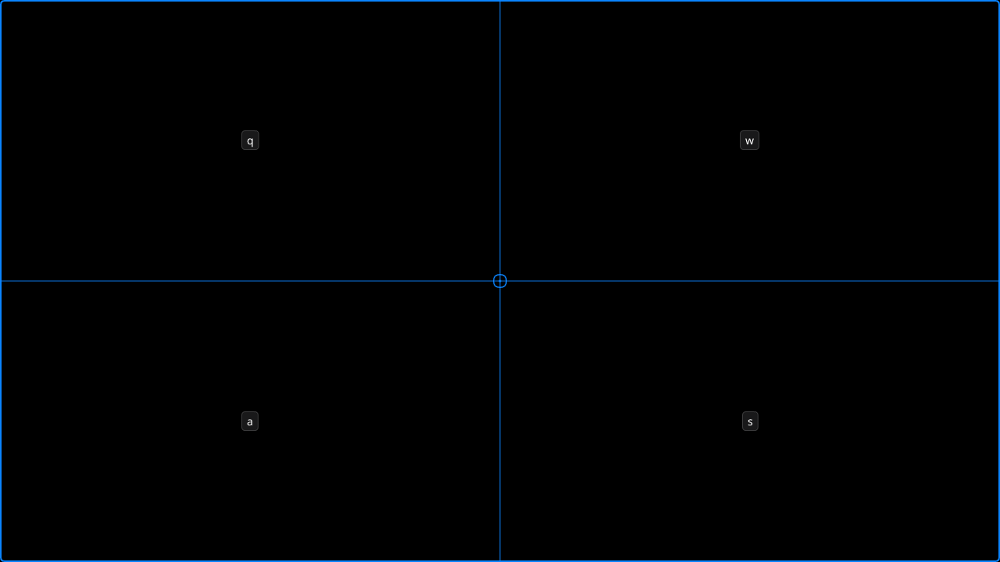
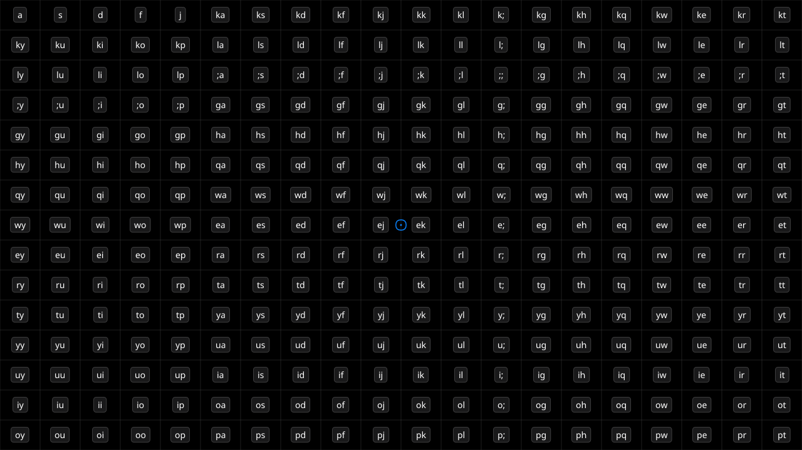

# windhover

Keyboard-driven mouse cursor for wlroots-based Wayland compositors.

> **windhover** — the kestrel: the falcon that hangs motionless in the air,
> watching, then drops onto exactly the thing it picked. The overlay hovers over
> your screen the same way, and the pointer lands where you aimed.

Three modes, one binary, no daemon:

| normal | grid | hint |
|---|---|---|
|  |  |  |

| Mode | Keys |
|---|---|
| **normal** | `h` `j` `k` `l` move (hold to accelerate, `Ctrl` for double) · digits are a multiplier · `H` `M` `L` jump to left / middle / right edge · `[` `\` `]` speed presets · `m` `,` `.` left / middle / right click · `v` drag · `g` grid · `f` hint · `Esc` quit |
| **grid** | `q` `w` `a` `s` pick a quadrant · repeat to shrink · `h` `j` `k` `l` pan the region · `BackSpace` undo · `Return` warp · `Space` warp and click · `Esc` quit |
| **hint** | a grid of cells, one or two characters per label · type a label · `BackSpace` edit (or return to normal when empty) · `Esc` quit |

Grid and hint hand off to normal mode for fine adjustment, so a session is one
continuous interaction rather than three separate tools.

## Why compositor hotkeys

Wayland does not let a client bind global hotkeys or grab the keyboard. warpd's
own manual states this and its Wayland port consequently requires one of the
mode flags to be used, bound to a hotkey in the compositor.

windhover takes the same route: a compositor keybinding launches it, it draws a
fullscreen overlay, takes the keyboard exclusively for the lifetime of the
overlay, moves the pointer through `zwlr_virtual_pointer_v1`, and exits. That
means no daemon, no IPC, no cross-invocation state, no root, and no
`/dev/uinput`.

## Requirements

The compositor must implement both:

- `zwlr_layer_shell_v1` — the overlay surface
- `zwlr_virtual_pointer_manager_v1` — absolute pointer positioning, buttons, wheel

| compositor | status |
|---|---|
| sway | supported, tested (26/26) |
| niri | supported, tested (26/26) |
| river, with a `river-window-management-v1` window manager such as [tailrace](https://github.com/riverwm/tailrace) | supported, tested (26/26) |

See [docs/compositors.md](docs/compositors.md) for how that was measured, and for
the per-compositor differences worth knowing about.

`fc-match` (fontconfig) is used to resolve the configured font family. When it
is unavailable, a built-in list of common font paths is probed instead.

## Build

```sh
cargo build --release
install -Dm755 target/release/windhover ~/.local/bin/windhover
```

See [docs/dependencies.md](docs/dependencies.md) for the dependency admission
rules and the audit command.

## Compositor setup

One binding is enough. It starts a session, and `g` and `f` enter grid and hint
mode from inside it — so one session serves as many jumps as you want, and each
selection or warp drops straight back into normal mode with `h` `j` `k` `l` still
under your fingers. `Escape` ends the session.

### sway

```
bindsym Mod4+Mod1+c exec windhover
```

### niri

```kdl
binds {
    Mod+Alt+C { spawn "windhover"; }
}
```

### river

```sh
riverctl map normal Super+Alt C spawn windhover
```

`Mod4+Mod1+c` is the binding warpd documents for normal mode. A session holds the
keyboard exclusively, so a second press of that hotkey cannot reach the
compositor while one is running — `Escape` is what gives the keyboard back.

### One key per press instead

The mode flags start a session in the mode they name, with no normal mode before
it: `windhover --hint` is a hint session from its first frame. A binding can
therefore go straight to the mode it wants.

```
bindsym Mod4+Mod1+x exec windhover --hint
bindsym Mod4+Mod1+g exec windhover --grid
```

What such a binding leaves behind is the session: after the jump it is in normal
mode and still running. That is what the binding above wants when you are happy to
keep one session — and what `--oneshot` takes away, for a binding you press per
jump rather than a session you stay in:

```
bindsym Mod4+Mod1+x exec windhover --hint --oneshot
bindsym Mod4+Mod1+g exec windhover --grid --oneshot
```

The window closes as soon as the pointer lands, so this cannot show you where it
landed, and a binding like this is not meant to sit next to the session above:
`--hint --oneshot` pressed while a session is still running stacks a second one,
which holds the keyboard and paints its own cursor ring.

## Usage

```sh
windhover            # normal mode, which is the default
windhover --grid     # a grid session from its first frame
windhover --hint     # and a hint session, with no normal mode first
windhover --hint --oneshot   # one jump, then exit
```

## Testing

```sh
cargo test                                  # unit tests

sh scripts/headless-check.sh sway           # end-to-end, per compositor
sh scripts/headless-check.sh river
sh scripts/headless-check.sh niri

sh scripts/capture.sh /tmp/shots            # one PNG per mode, for looking at
cargo deny check advisories bans            # dependency audit
```

The end-to-end check boots sway on the headless wlroots backend and drives
windhover through `examples/virtual_keyboard.rs`. A headless compositor has no
input devices, so its seat advertises no keyboard at all until a
`zwp_virtual_keyboard_v1` client attaches one — which is why the check can also
assert the refusal path.

```sh
cargo deny check advisories bans   # RustSec advisories and the build-script allowlist
```

## Diagnostics

A session is a client of a compositor nobody here runs, and the failures that
matter are the ones it never sees: a key the layout cannot produce, a key release
that never arrives, a keyboard taken away without a `leave`. Two things help.

`--trace` prints what the session observed — the keyboard focus, every key with
the keysym it resolved to, every keymap it installs, mode changes, and one line
per turn of its event loop that did something. Include it, redirected to a file,
in a report:

```sh
windhover --hint --trace 2>/tmp/windhover.log
```

And when the layout a session is given has no key for one of its bindings, it
says so instead of leaving that binding quietly dead:

```
windhover: this keyboard layout cannot produce these bindings, so they will do
nothing: quit (Escape)
```

## Configuration

`$XDG_CONFIG_HOME/windhover/config`, falling back to
`~/.config/windhover/config`. One option per line:

```
<option>: <value>
```

Blank lines and lines starting with `#` are ignored. Options that take keys
accept several space-separated values, may be listed more than once, and can be
cleared with `unbind`.

## Documentation

- [docs/configuration.md](docs/configuration.md) — every option, with a sample file
- [docs/compositors.md](docs/compositors.md) — per-compositor notes and how they were tested
- [docs/theme.md](docs/theme.md) — the theme as the single source of the visual language
- [docs/dependencies.md](docs/dependencies.md) — dependency admission rules and audit
- [openspec/changes](openspec/changes) — specifications and design decisions
